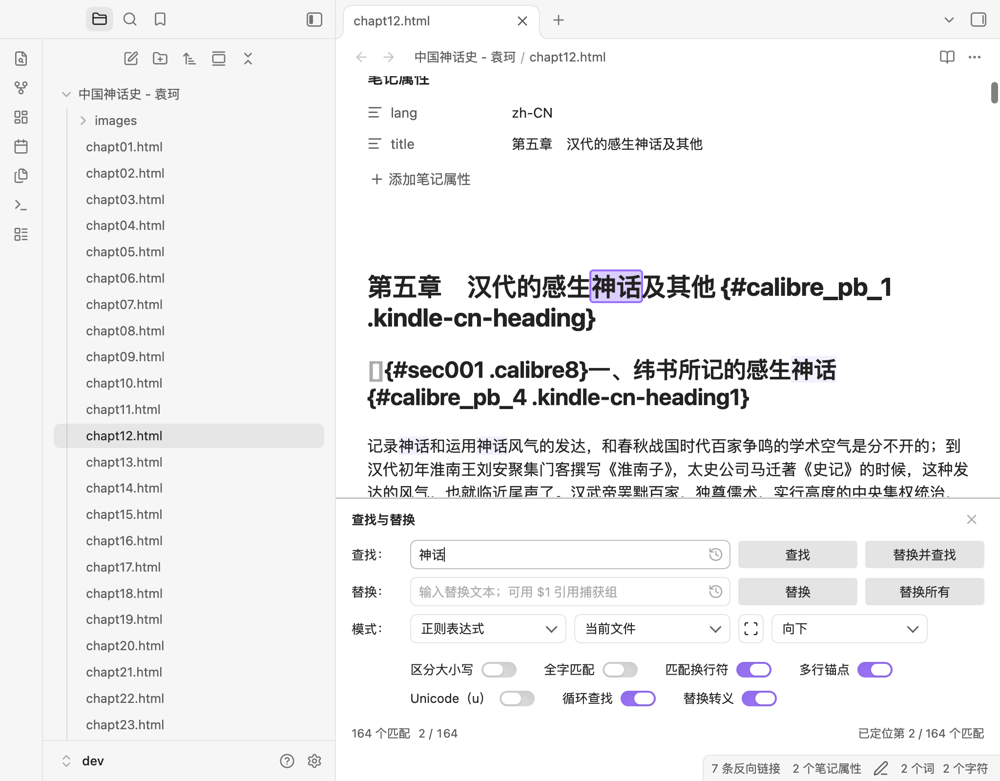
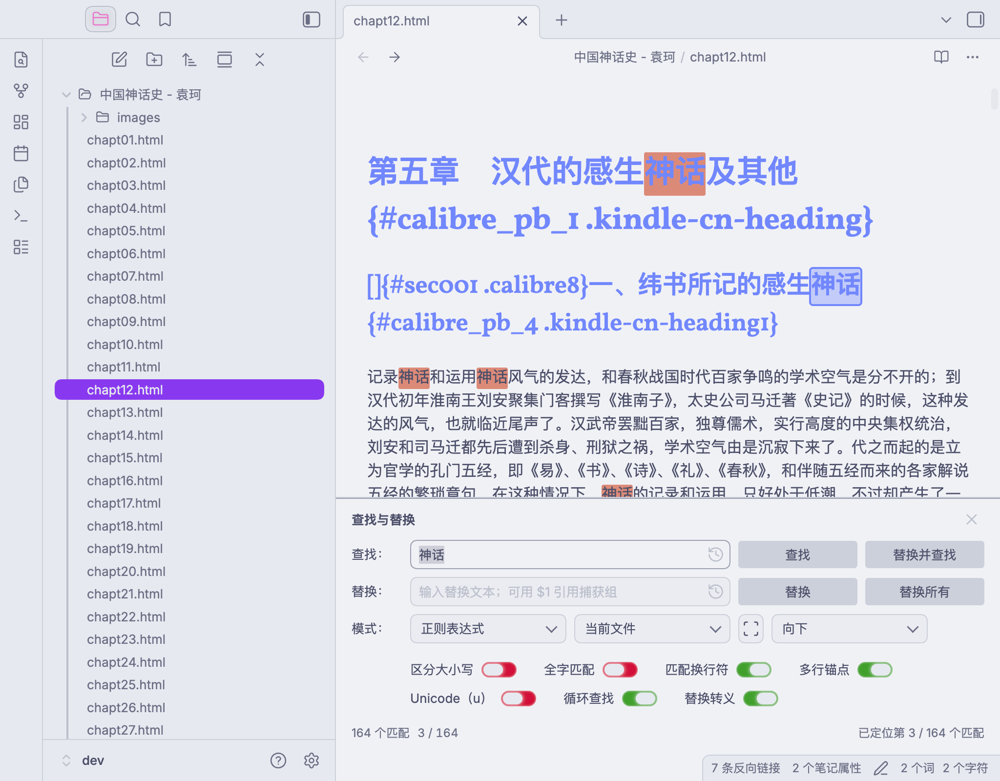
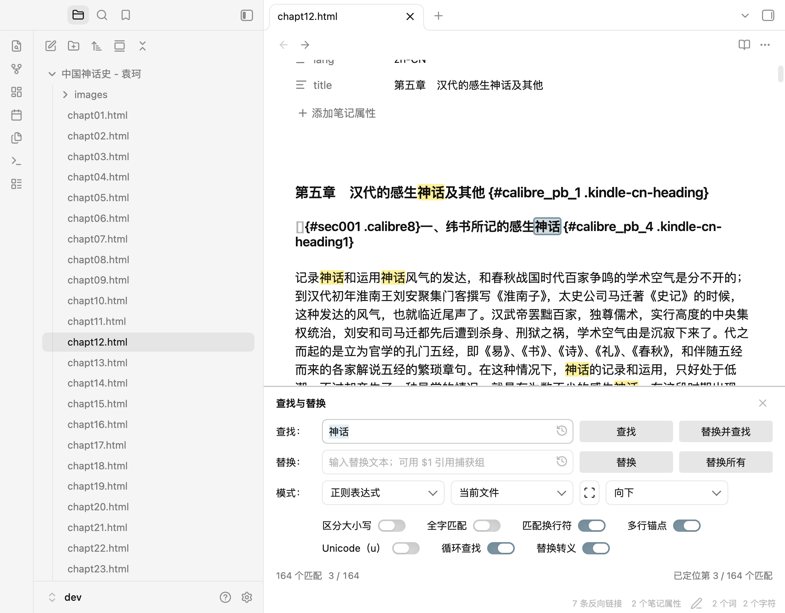
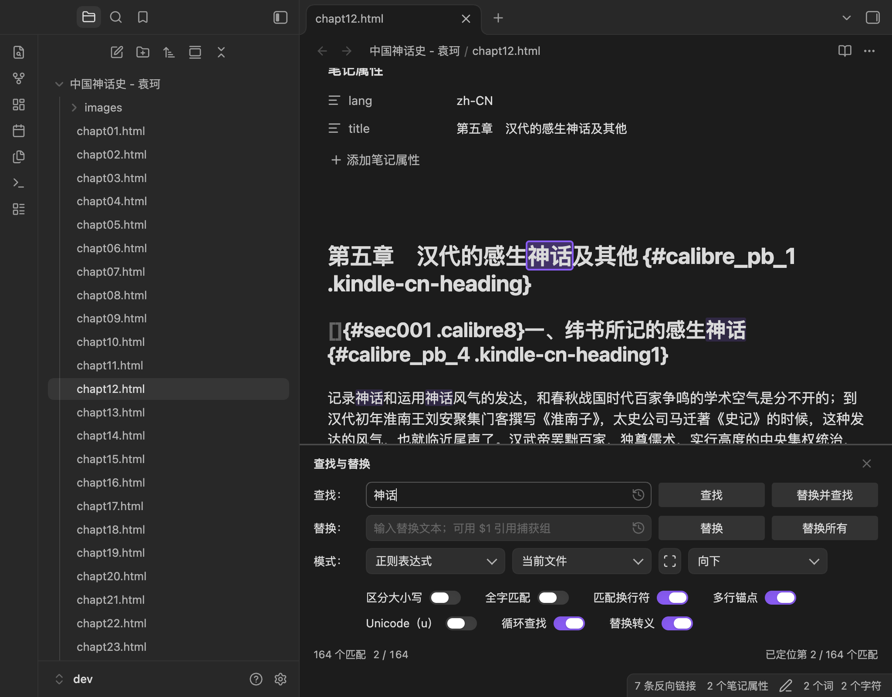
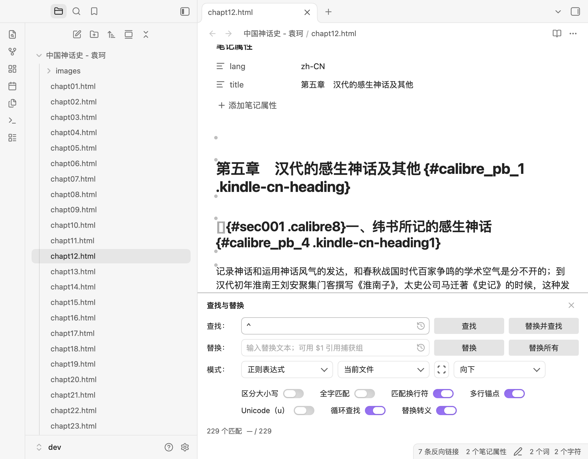
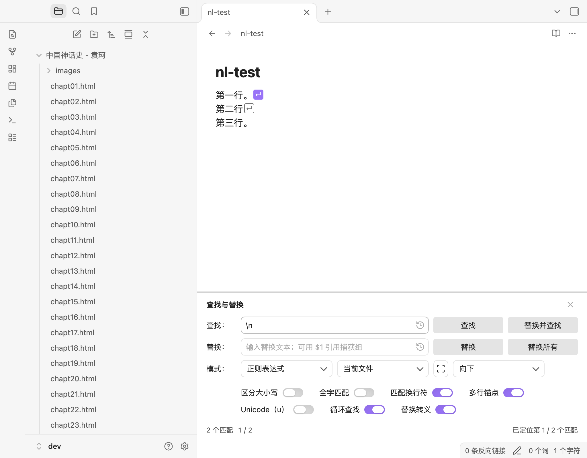
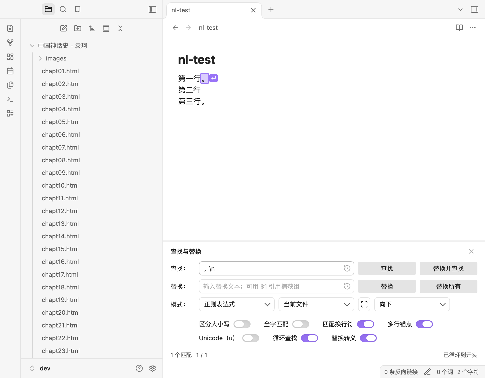
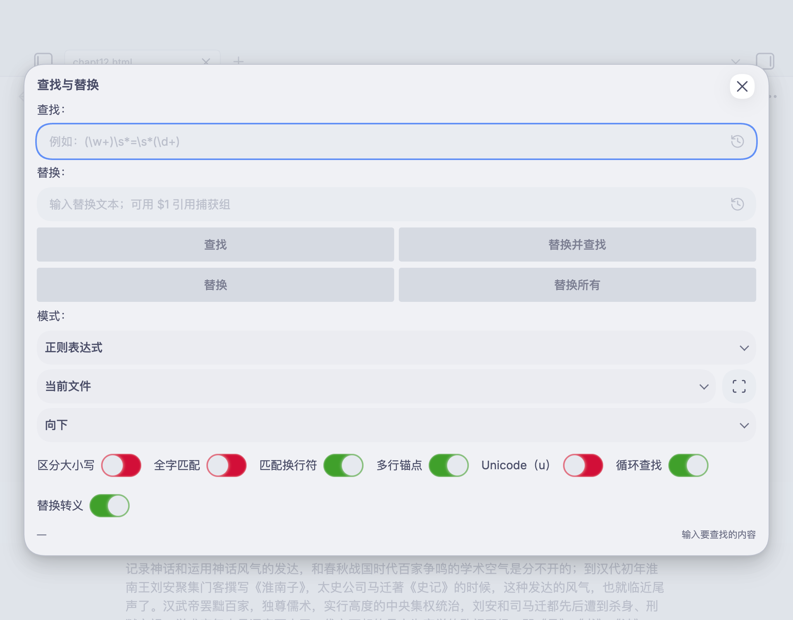

# Implementation Record — v0.3.3 (Unicode, accessibility, themes)

Status: **implemented on branch `v0.3.0`, pending acceptance; development continues on the branch until the next stable version**. E2E-verified in the local dev vault (Obsidian 1.15.0, macOS, Chinese/light and dark UI). The 0.2.6 baseline is listed in the community directory; 0.3.3 is the first public release candidate, pending acceptance, merge, tag, and directory update. 0.3.0/0.3.1/0.3.2 were internal only. See [CHANGELOG.md](CHANGELOG.md) and [COMMUNITY-READINESS.md](COMMUNITY-READINESS.md).

v0.3.3 keeps the 0.3.2 marker/selection layer and adds a regex-only Unicode (u) option, accessibility landmarks/grouping, a Chromium AX-tree audit, and third-party theme adaptation for Catppuccin and Minimal.

## Screenshots (real Obsidian window, Chinese/light and dark)

Desktop inline panel: all matches in the visible note are highlighted, the active match has an accent outline, and the status shows `164 个匹配  21 / 164`:



Catppuccin (enabled) and Minimal theme checks:





Dark theme with the same all-match/active distinction:



Zero-width matches (`^` with multiline anchors): translucent gray dots, with a filled active dot and halo:



Newline-only match (`\n`): each line break gets an `↵` pill; the active break is filled:



Mixed match (`。\n`): the visible character is highlighted and the break gets a marker:



Mobile / fallback dialog:



## Architecture

### All-match decorations — `src/editor/inline-panel.ts`

- `StateEffect` `setInlineMatchHighlights` carries `{ ranges, active, lineBreaks? } | null`; `matchHighlightField` stores one `DecorationSet`.
- Marks: `.rr-match-highlight` for every match, `.rr-match-highlight-active` for the active range.
- Zero-width ranges become `Decoration.widget` instances (`.rr-zero-width`, active `.rr-zero-width-active`). They are translucent gray filled dots for inactive matches and filled accent dots with a `--background-primary` halo for the active match; the shape no longer resembles a blockquote border.
- Newline positions inside a match text become `LineBreakMarker` widgets (`.rr-line-break`, active `.rr-line-break-active`) displaying `↵`. A newline-only match has no mark, but its marker is visible; `。\n` shows both the character mark and the marker.
- `src/editor/highlights.ts` has two pure planners: `buildHighlightPlan()` clamps, sorts, de-duplicates, prioritizes the active range, and applies the 5,000 mark / 1,000 zero-width caps; `buildLineBreakPlan()` de-duplicates line-break positions, marks the active range, and caps at 1,000 markers while preserving the active break.
- The existing `setTimeout(0)` coalescing remains; highlight requests from a CodeMirror update or panel mount are dispatched after the current update completes.
- `closeInlinePanel` clears highlights and closes the panel in one transaction.

### Editor-focus navigation

- `panelControllers` now exposes `focus`, `findNext`, `findPrevious`, and `close`.
- `createInlinePanelExtension` returns `Prec.high(keymap.of(F3, Shift-F3, Escape))`. Handlers return `false` when no panel controller exists, so normal editor behavior is untouched when the panel is closed.
- The panel's own input key handling remains unchanged.

### Position and selection tracking

- `FindReplacePanel` tracks `activeIndex`, `matchCount`, and `truncated`; `collectLineBreaks()` derives absolute `\n` positions from matched text and sends them with each highlight request.
- After each scan, the selected range is matched against the scanned matches; `refresh()` re-derives the position so reopening the panel with a selected match shows the correct index.
- CodeMirror `selectionSet` updates call `handleSelectionChange()`; it only re-syncs when the active index actually changes.
- The status row is now `count + position` on the left and the action message on the right.
- Document changes reset the position and schedule the debounced refresh.

### Unicode (u) option — `src/search/`, `src/settings.ts`, `src/ui/FindReplacePanel.ts`

- `SearchOptions.unicode` and `SearchUiState.unicode` default to `false` and are normalized from persisted state.
- The regex-only `Unicode (u)` toggle adds the `u` flag in `flagsFor()`.
- It enables `\p{...}` property escapes and code-point matching; exact/wildcard hide it and ignore it.
- `optionUnicode` / `tooltipUnicode` / `optionsGroup` strings exist in English and Chinese.

### Accessibility — `src/ui/FindReplacePanel.ts`

- `.rr-panel` is a labelled `region`; the inline title is a level-2 heading.
- The option row is a labelled `role=group`; every toggle is a native checkbox with a name.
- History buttons expose `aria-haspopup="menu"` and `aria-expanded`, updated on menu open/hide.
- The existing message remains `role=status`, `aria-live="polite"`, `aria-atomic="true"`.
- The Chromium accessibility tree was audited with `Accessibility.getFullAXTree` (the tree Chromium maps to Windows UIA).

### Themes — `styles.css`

- Active match now uses a 35% `--interactive-accent` tint plus a 2px accent outline instead of the selection color alone. This keeps it stronger than the inactive `--text-highlight-bg` fill on Catppuccin, where the highlight background is opaque.
- Catppuccin (enabled) and Minimal were tested in light mode; panel chrome, switches, status, scope button, zero-width dots, and `↵` markers remained visible.

### Selection refresh — `src/ui/FindReplacePanel.ts`

- A scan-icon selection-refresh button sits inside `.rr-scope-control` next to the scope selector.
- Clicking it captures the current editor selection, switches the scope to Selection, re-renders the panel, and reports “Selection updated”.
- With no selection it resets to Current file and reports the existing “no selection” message.
- The button has an ARIA label, tooltip, hover/pressed/focus-visible styling, and a 28px width override in `.rr-narrow`; 44px in the mobile media/body rules.

### History and settings — `src/main.ts`, `src/ui/FindReplacePanel.ts`

- History buttons use the Lucide `history` icon instead of a chevron that looked like a dropdown.
- Panel-driven settings writes go through `scheduleSaveSettings()` with a 500ms debounce; `saveSettings()` remains immediate for the settings tab, and `onunload` flushes a pending write.
- If a panel is destroyed during unload, `unloading` makes the save immediate rather than scheduling after unload.

### Line-break cache — `src/editor/highlights.ts`

- `collectLineBreakPositions(matches)` is a pure function with unit tests.
- The panel computes the absolute positions when `buildContext()` assigns a new match set and reuses `this.lineBreaks` for highlight syncs and active-index changes.

### Bounded replace-all

- Limits live in `src/search/limits.ts`:
  - display scan `10_000`;
  - action scan `100_000`;
  - highlight ranges `5_000`;
  - zero-width markers `1_000`;
  - line-break markers `1_000`;
  - confirmation threshold `5_000`.
- Find / Replace / Replace-all scan with the action limit instead of `Infinity`.
- Replace all refuses to run when the scan is truncated; above 5,000 matches it opens an Obsidian `ConfirmationModal` (1.13+). The cancel button has initial focus; confirming re-scans and executes one transaction.
- The count shows `10000+` when the display scan is truncated; the position uses the same display total.

### UI/CSS

- `.rr-status-left` groups the count and position; `.rr-position` uses tabular numerals.
- `.rr-match-highlight` uses `var(--text-highlight-bg, color-mix(... --text-selection ...))`; the active class uses `var(--text-selection)` plus an accent outline so the distinction is not color-only.
- `.rr-zero-width` is a 6px translucent-gray filled circular dot above the insertion point for inactive matches; `.rr-zero-width-active` is filled accent with a background-colored halo. Both use a zero-layout-width pseudo-element, so text does not shift.
- `.rr-line-break` is an absolutely positioned `↵` pill at the line end; `.rr-line-break-active` is accent-filled with `--text-on-accent` text. It does not change line width.
- Below 260px, `.rr-narrow` stacks the four action buttons one per row and lets `.rr-status-left` wrap; this avoids clipped action labels in very narrow panes.
- `ResizeObserver` compact updates are coalesced through `requestAnimationFrame` and skipped when the width is unchanged; the initial update happens before observing. This avoids ResizeObserver loop warnings during viewport/popout resizes.

## What was built

| Area | Status |
|---|---|
| Three modes (exact / wildcard / regex) | done |
| Four actions (find, replace once, replace & find, replace all) | done |
| Native toggle options and mode-aware visibility | done |
| All-match highlighting | done |
| Active match with distinct outline | done |
| Persistent `position / total` | done |
| Zero-width match markers (translucent gray / accent dots) | done |
| Unicode (u) regex option | done |
| Chromium AX-tree accessibility audit | done (full screen reader pending) |
| Catppuccin / Minimal theme audit | done |
| Line-break markers (`\n`, `。\n`) | done |
| F3 / Shift+F3 / Escape from the editor | done |
| Replace-all confirmation above 5,000 | done |
| 100,000 action-scan cap and `10000+` display | done |
| Current-file / captured selection scope | done |
| Live count + status/error messages | done |
| History (20, clear, persist, history icon) | done |
| Use current selection refresh | done |
| Debounced panel settings saves | done |
| Cached line-break positions + pure tests | done |
| Desktop inline panel, compact/narrow layout, multi-window | done (0.2.6 regression baseline; 0.3.2 narrow fix) |
| Mobile modal fallback | done |
| Declarative settings | done |
| Unit tests, lint, type-check, build | done |

## Verification performed

### Static

```bash
npm test          # 6 files, 61 tests passed
npx tsc -noEmit   # passed
npx eslint .      # 0 errors, 0 warnings
npm run build     # main.js produced (v0.3.3, ~48 KB)
```

### Obsidian end-to-end (dev vault)

- Plugin `0.3.3` loads and reloads with no `dev:errors`; manifest version 0.3.3.
- Desktop panel opens in `.cm-panels-bottom`; status shows `164 个匹配  — / 164` before Find.
- All-match highlighting: 164 matches, 17 visible `.rr-match-highlight` nodes in the viewport; Find adds one `.rr-match-highlight-active` and shows `3 / 164` plus “已定位第 3 / 164 个匹配”.
- Selecting a body match with the editor API updates the position to `11 / 164` and adds the active class. Moving the caret off matches returns `— / 164` and removes the active class.
- Closing and reopening the panel with a selected match restores `11 / 164` and the active highlight.
- Zero-width: `^` with multiline anchors produced 229 matches; 16 visible translucent-gray `.rr-zero-width` dots; Find produced one filled `.rr-zero-width-active` and `9 / 229` (later `47 / 229` in the scrolled test).
- Newline: regex `\n` on the 55 KB note produced 228 matches and 24 visible `.rr-line-break` pills; Find produced one `.rr-line-break-active` and `47 / 228`, with no `.rr-match-highlight` (the break has no glyph).
- Mixed `。\n` on a small note: 1 match, 1 `.rr-match-highlight` containing `。`, 1 `.rr-line-break`, and the marker sits at the line end.
- Dark theme: zero dot, active dot, and `↵` markers use theme variables; inactive vs active contrast is visible.
- Editor-focus keys: F3 from `.cm-content` moved `9 / 229 → 10 / 229`; Shift+F3 returned to `9 / 229`; Escape closed the panel and left focus in the editor.
- Replace all: `.` on the 55 KB note produced 19,588 matches; Replace all opened “替换全部匹配？” with “确定替换 19588 处？” and Cancel focused; Cancel closed the modal without changes.
- Replace all on a 6,000-match scratch note: confirmation → replace → `已替换 6000 处，可撤销`; undo restored all 6,000 characters.
- Safety cap: a 150,000-match scratch note shows `10000+` and Replace all reports “结果超过 100000 条，请缩小查找范围” without opening a modal.
- 1 MB scratch note (10,500 matches): input-to-count update 184.9 ms including the 180 ms debounce; `10000+` count and 10 visible highlights; `dev:errors` empty.
- 1 MB / 10,500-line note: `\n` count `10000+` in 185.4 ms including debounce; dotAll `.*` 185.3 ms; zero-width `^` 188.5 ms; visible markers capped and no freeze.
- Selection scope (`第一段。\n第二段\n第三段。`): `\n` → 1 match/1 marker; `。\n` → 1 match, 1 character mark, 1 active `↵`; offsets are absolute and correct.
- Compact widths: 700px viewport → 324px panel (compact), 500px → 124px panel (compact + narrow). At 124px, actions are one per row, labels fit, status-left wraps, status height 44px, no horizontal overflow; the panel uses the documented 70vh internal scroll.
- Document edit with `\n` search: inserting a real newline updates 2 → 3 matches/markers; undo returns to 2. Replace all of `\n` with `|` gives `a|b|c`, `无匹配`, and undo restores `a\nb\nc`.
- Popout window: main and popout panels are independent; F3 in the popout changes `1 / 2 → 2 / 2`; Escape closes only the popout panel. Closing the popout through `workspace:close-window` leaves the main panel open and logs no errors.
- ResizeObserver regression: manual width changes and CDP viewport changes (700px, 500px) produce no `ResizeObserver loop` errors after the rAF/width guard. Forcing `leaf.detach()` on a popout can still produce browser resize warnings; normal window close does not.
- Scope refresh: selected `神话` in the body → selection-refresh button set scope to Selection, 1 match, “已更新选区范围”; with a collapsed selection it reset to Current file and reported the no-selection message.
- History buttons render `svg.lucide-history`; the desktop mode row fits with the new 26px scope button (no overflow).
- Debounce: `data.json` mtime unchanged 120ms after Find and updated after 500ms; settings tab still uses immediate `saveSettings`.
- Narrow scope control: 124px panel keeps “当前文件” in a 90px select and a 26px refresh button; no horizontal overflow.
- Unicode: `\p{Script=Han}+` finds 2,665 runs with the toggle on; the same pattern finds nothing with it off. Astral `.` is one match with `u` and two surrogate halves without it. The toggle is hidden in exact/wildcard modes and restored on reopen.
- Accessibility tree: region “查找与替换”, heading level 2, group “查找选项”, seven named checkboxes (including Unicode), three named comboboxes, live status, and history `aria-expanded=false`.
- Keyboard audit: Tab went find input → find history → Find → Replace and find → replace input → replace history → Replace → Replace all → mode → scope → Use current selection → direction → seven option toggles → workspace; Escape closed the panel and returned focus to the editor.
- Themes: Catppuccin and Minimal both render the panel, active/inactive highlights, toggles, scope button, zero-width dots, and newline markers; active match uses a 2px accent outline. Theme screenshots: [Catppuccin](docs/screenshots/theme-catppuccin.png) · [Minimal](docs/screenshots/theme-minimal.png).
- Mobile emulation: `.modal.rr-modal` opens single-column, 44px controls, 7 regex options; Find updates `2 / 164`; scope and history icons render at 20px after the tablet-padding fix; no errors.
- Scratch notes were deleted after testing; no content changes were left in the dev vault.

### Known limitations

- Highlight rendering is capped at 5,000 ranges / 1,000 zero-width dots / 1,000 line-break markers; the count and position still report the full scanned total.
- Replace-all is blocked above 100,000 matches rather than offering a chunked or background replacement.
- The mobile modal has no custom decorations; it relies on the native selection, count, and position.
- CM6 decorations in YAML frontmatter/properties are not independently verified; the editor's property widgets may not show marks that exist in the raw document.
- Real iOS/Android and Windows/Linux are not re-tested for 0.3.3; third-party themes tested are Catppuccin and Minimal.
- Accessibility used the Chromium AX tree; a full VoiceOver/Narrator session is still outstanding.
- At 124px panel width the compact panel is taller than 70vh and the status row requires internal scrolling; this is the documented narrow-window tradeoff.
- Programmatic popout teardown with `leaf.detach()` still emits browser ResizeObserver warnings in some runs; normal `workspace:close-window` was clean.
- Multiline literal inputs, preserve case, vault-wide replace, and the `y`/`d`/`v` flags remain out of scope.

## Install / update

Build artifacts at the project root: `main.js`, `manifest.json`, `styles.css`.

Dev vault used for verification:

```
/Users/hanluica/Documents/Obsidian/dev/.obsidian/plugins/regex-replace-rev/
```

For another vault, copy the same three files into `<vault>/.obsidian/plugins/regex-replace-rev/` and enable the plugin. `main.js` is intentionally gitignored and must be attached to the GitHub release as a build artifact.

## Main files

- `src/main.ts` — plugin lifecycle, command, editor/window targeting, host selection
- `src/editor/inline-panel.ts` — CM6 panel extension, all-match decoration field, zero-width widget, keymap
- `src/editor/highlights.ts` — pure highlight/line-break planning and cached line-break collection (clamp/sort/dedupe/caps)
- `src/ui/FindReplacePanel.ts` — shared UI/behavior, position, scope, history, confirmation
- `src/ui/FindReplaceModal.ts` — mobile/fallback dialog
- `src/ui/host.ts` — shared host contracts
- `src/settings.ts` — settings/state model, declarative settings tab
- `src/i18n/` — en/zh strings
- `src/search/` — pure engine; `src/search/limits.ts` guard rails
- `styles.css` — inline separator, highlights, zero-width dots, line-break markers, compact/mobile styling
- `tests/` — 61 unit tests across 6 files
