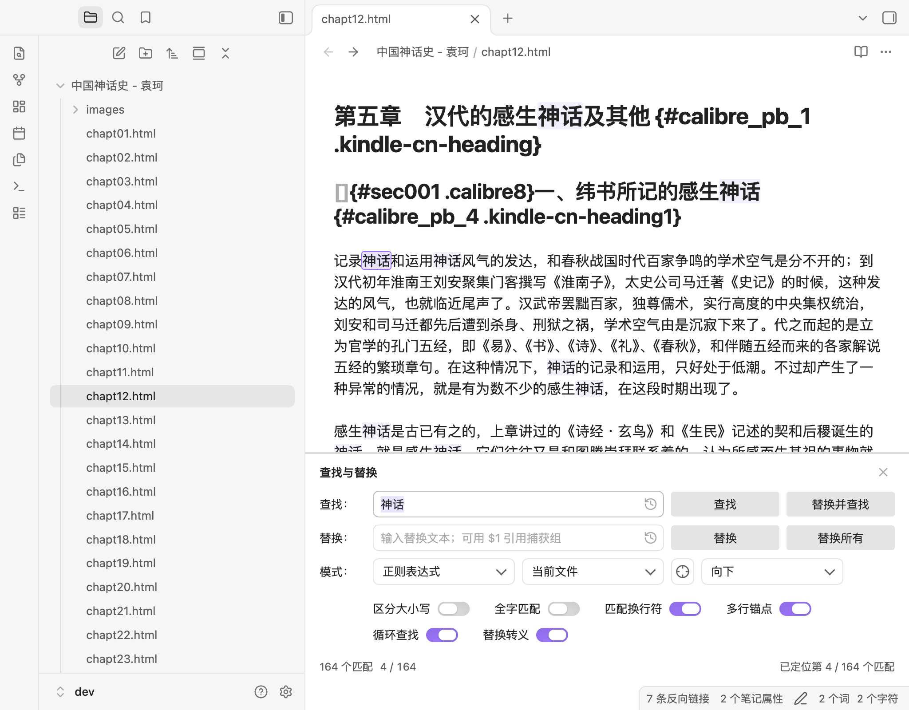
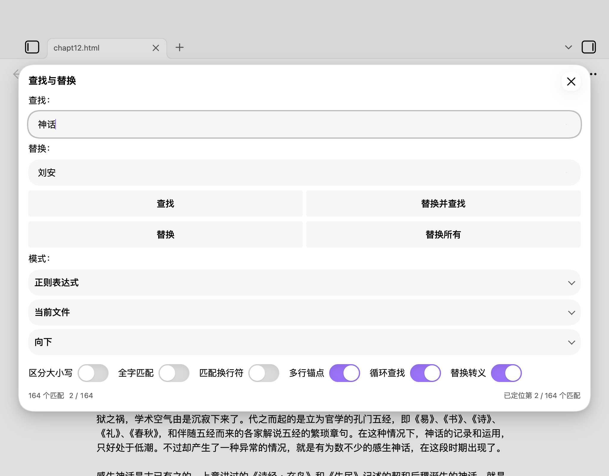

# Regex & Wildcard Find/Replace

A find/replace panel for Obsidian with **exact**, **wildcard**, and **regular expression** matching. On desktop it is embedded at the bottom of the note area, separated by a thin line with a title and close button; on mobile it falls back to a dialog.





## Features

- **Three match modes**: exact text, wildcard (`*`, `?`), and JavaScript regular expressions.
- **Four actions**: Find, Replace (one occurrence), Replace and find, Replace all.
- **Mode-aware search options**: native Obsidian toggle switches for case sensitive, whole word, wrap around, **Match newlines**, and **Replace escapes**. Exact mode shows 4; wildcard adds Match newlines (5); regex adds Match newlines and Multiline anchors (6). Match newlines uses the `s` flag: in wildcard mode `*`/`?` can cross lines; in regex mode `.` can cross lines. Multiline anchors (`m`) are regex-only. Toggle options use generous spacing (28px desktop, 16px compact/mobile) and wrap naturally; the panel height follows the rows.
- **Inline desktop panel**: embedded at the bottom of the note display area, separated by a single high-contrast 1px line, with a title and close button. It takes layout space instead of covering the note, so the editor stays visible and interactive.
- **Multi-window**: each Obsidian window has its own panel; the command targets the editor of the window it is invoked in and closing one window’s panel does not close the others.
- **Visible current match**: the current match is highlighted in the note even while the find field keeps focus, so Find always shows where it landed.
- **Compact actions**: the four action buttons use a desktop size close to Obsidian settings controls, with hover and pressed (accent) feedback.
- **Mobile / fallback**: the same controls in a modal dialog when Obsidian reports mobile mode.
- **Scope and direction**: current file or captured selection; down or up.
- **Match count and status**: live count, invalid-regex errors, wrap/boundary feedback, replacement results.
- **History**: last 20 search and replacement terms, with a clear action.
- **Undo-safe**: every replacement is a single `editor.transaction`; one undo restores it.
- **Unicode-aware whole word**: works for Latin and CJK text, without regex lookbehind.
- **Bilingual**: English and Simplified Chinese, following Obsidian's language.

## Status

Current version: **0.2.4**. The `0.2.4` tag is published on GitHub. Download the release assets from the [latest release](https://github.com/hluica/obsidian-regex-replace-rev/releases/latest); the plugin is not yet listed in Obsidian's community directory. Release audit: [COMMUNITY-READINESS.md](COMMUNITY-READINESS.md).

## Installation

### From a GitHub release

1. Open the [latest release](https://github.com/hluica/obsidian-regex-replace-rev/releases/latest).
2. Download `main.js`, `manifest.json`, and `styles.css`.
3. Create `<your-vault>/.obsidian/plugins/regex-replace-rev/` and place the three files there.
4. In Obsidian, open **Settings → Community plugins**, turn off Restricted mode if needed, and enable **Regex & Wildcard Find/Replace**.
5. Optionally assign a hotkey to **Find and replace in current file** in **Settings → Hotkeys**.

The plugin id is `regex-replace-rev`; the folder name should match it.

### From source

See [Development](#development) below. Build with `npm install && npm run build`, then copy the three build files into the vault plugin folder.

### From the community directory

Once the plugin is listed, install it from **Settings → Community plugins**. Until then, use the GitHub release or source installation above.

## Usage

Run **Find and replace in current file** from the command palette (command id `regex-replace-rev:open-find-replace`).

On desktop, the command opens the panel at the bottom of the active note. Running it again focuses the existing panel. Close it with the panel’s ✕ or Escape. The panel belongs to the note view it was opened in.

### Keyboard

| Focus                 | Key           | Action                             |
| --------------------- | ------------- | ---------------------------------- |
| Find field            | Enter         | Find next in the current direction |
| Find field            | Shift+Enter   | Find previous once                 |
| Find / replace fields | Mod+Enter     | Replace all                        |
| Find / replace fields | F3 / Shift+F3 | Find next / previous               |
| Replace field         | Enter         | Replace and find                   |
| Replace field         | Shift+Enter   | Replace once                       |
| Panel                 | Escape        | Close the inline panel             |
| History button        | Enter / Space | Open history menu                  |

Mod is Cmd on macOS and Ctrl elsewhere. Buttons are reachable with Tab and Enter/Space.

## Matching syntax

### Exact

The find text is literal; `*`, `?`, `.`, `$` are ordinary characters. The replacement is inserted literally (no `$1` expansion). Case sensitivity and whole-word options apply.

### Wildcard

- `*` — any sequence (including empty).
- `?` — any single character.
- `\*`, `\?`, `\\`, `\n`, `\r`, `\t` — escapes.
- By default `*` and `?` do not cross line breaks; enable **Match newlines** to let them cross lines.
- A trailing `*` consumes the rest of the line (or the rest of the document with Match newlines on); a `*` in the middle stops at the next literal so repeated matches do not swallow the document.
- Each `*` / `?` is a capture group, in order. Replacement supports `$1`…`$n`, `$&`, and `$$`.
- Character classes (`[abc]`) and quantifiers (`{n,m}`) are not supported in wildcard mode; use regex mode for those.

Example: `第*章` with replacement `第$1节` turns `第1章` into `第1节`.

### Regular expression

- JavaScript `RegExp` syntax. Enter the pattern only; do not include `/.../flags`.
- `g` is implicit. The **Case sensitive** option removes the `i` flag; **Match newlines** adds `s`; **Multiline anchors** adds `m`.
- Replacement supports `$1`…`$99`, `$&`, `$$`, `` $` ``, `$'`, and `$<name>`.
- Zero-width matches (e.g. `^`, `\b`, `(?=...)`) are supported.
- Lookbehind is intentionally not used, for iOS compatibility.

### Whole word

Whole word uses a Unicode boundary filter (letters, numbers, marks, and `_`), not `\b`. It works with CJK text: `项目` matches in `项目：` but not inside `本项目`.

Known edge case: with a regex alternation such as `foo|foobar`, the engine may match `foo` first and reject it at the boundary instead of trying `foobar`. Put the longer alternative first or add explicit boundaries.

### Replacement escapes

Enable the **Replace escapes** toggle in the panel to convert `\n`, `\r`, `\t`, and `\\` in the replacement before `$` expansion. The toggle is saved with the rest of the panel state. This is useful because the input fields are single-line.

## Scope

- **Current file** — the whole document.
- **Selection** — the selection captured when the panel opens or when you switch the scope to Selection. The captured range is updated after replacements. It resets to Current file if the note content changes to another document.
- To pick a different selection in the same note, switch to Current file and back to Selection, or close and reopen the panel.

## Settings

- **Remember the last search and options** — restore the last pattern, replacement, and options.
- **Prefill the find field from the selection** — use a single-line selection when opening.
- **Remember search history** — keep the last 20 terms; turning it off clears the history.
- **Default match mode** — used when remembering the last state is off.

All data is stored in the plugin's `data.json` under `plugin.settings`.

## Limitations

- Find and replace are limited to the current file (or captured selection); there is no vault-wide replace.
- The input fields are single-line; use regex `\n` or the panel's **Replace escapes** toggle for line breaks.
- No all-matches highlight; the current match is selected and scrolled into view, and the count/status show progress.
- The `u` regex flag is not exposed. Unicode property escapes that require `u` are not available in current version.
- Word-level regex alternation has the boundary caveat described above.
- The inline panel sits at the bottom of the editor content column; in a narrow split pane it switches to a compact stacked layout. Very narrow windows cap it at 70vh and scroll internally.
- On mobile the panel is presented as a dialog rather than embedded.

## Development

```bash
npm install
npm test
npx tsc -noEmit
npm run lint
npm run build
```

The build produces `main.js` at the project root; copy it with `manifest.json` and `styles.css` to a vault plugin folder. The inline panel is a CodeMirror 6 `showPanel` extension (`top: false` → bottom). The project uses TypeScript, esbuild, Vitest, ESLint with `eslint-plugin-obsidianmd`, and CodeMirror 6 packages provided by Obsidian at runtime.

## Acknowledgments

- The plugin is generated by DeepSeek-V4.1-flash-1017.
- The plugin is inspired by [obsidian-regex-replace](https://github.com/Gru80/obsidian-regex-replace).
- Its UI is inspired by Calibre Ebook-Editor.

## License

MIT. See [LICENSE](LICENSE).
