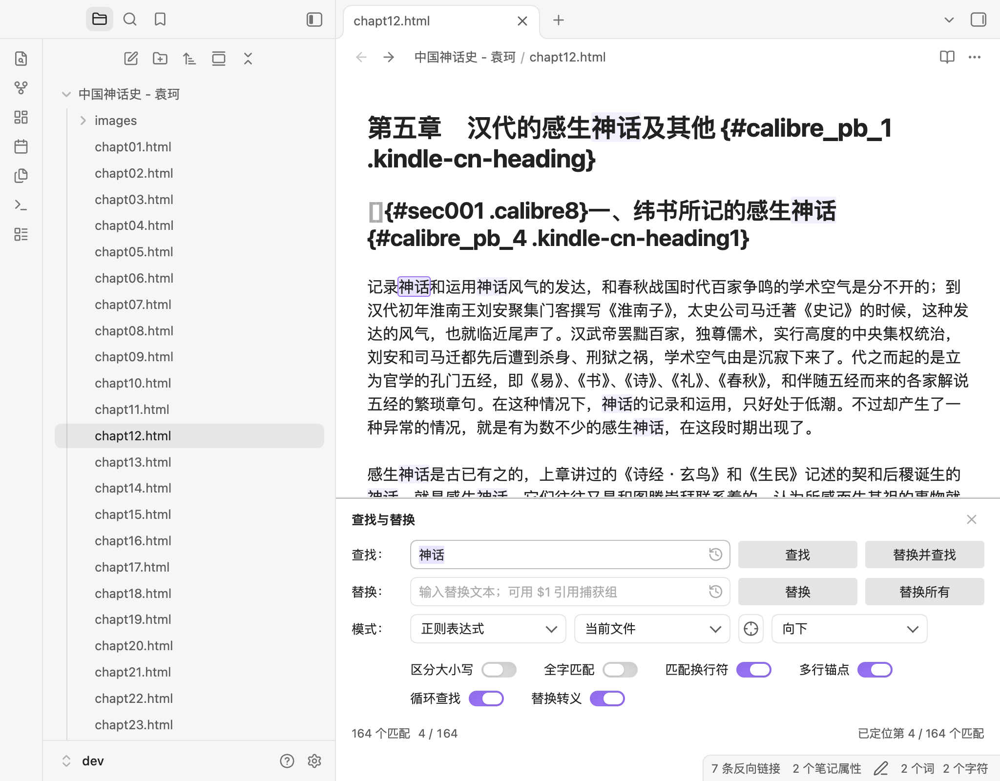
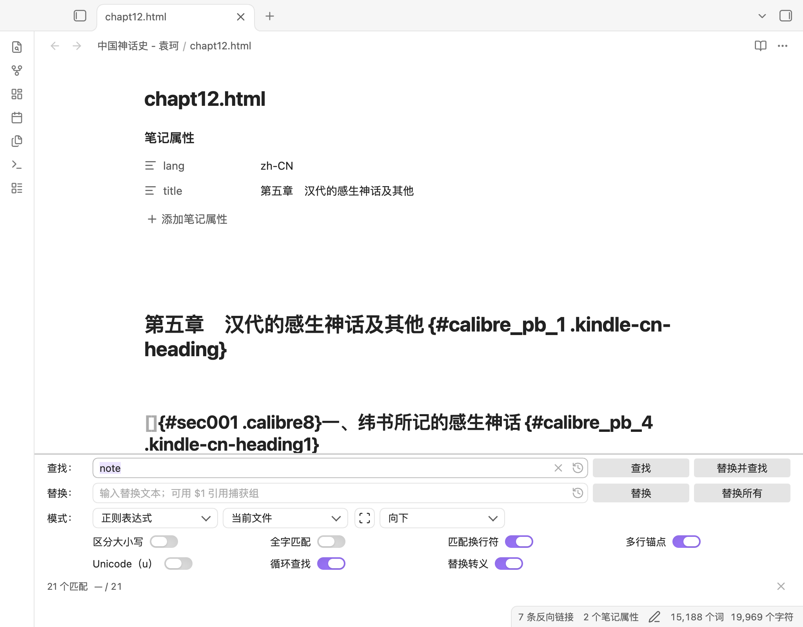
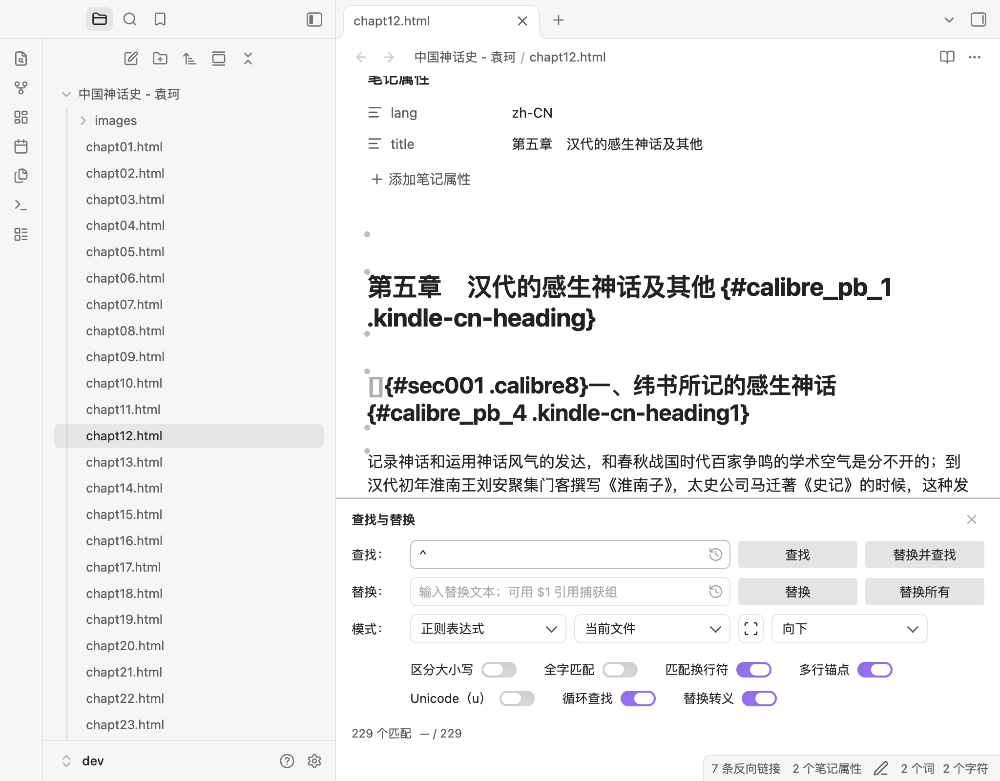
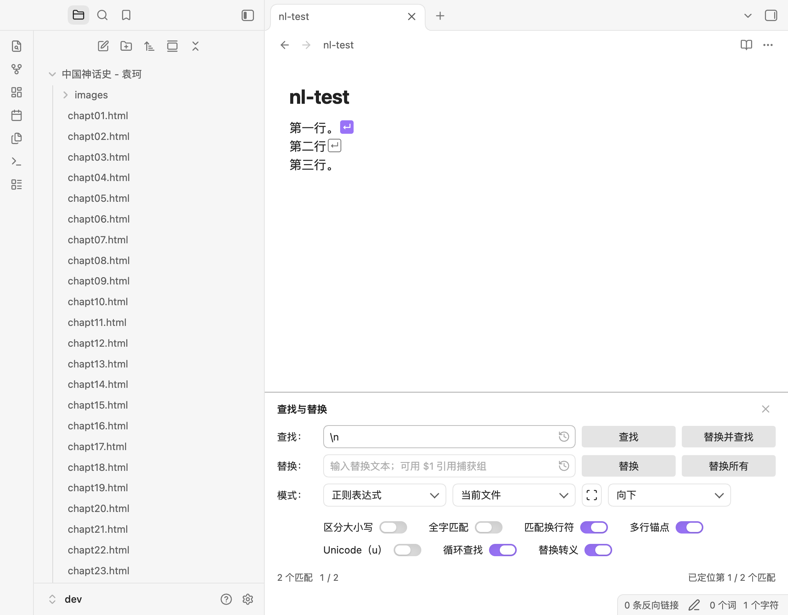
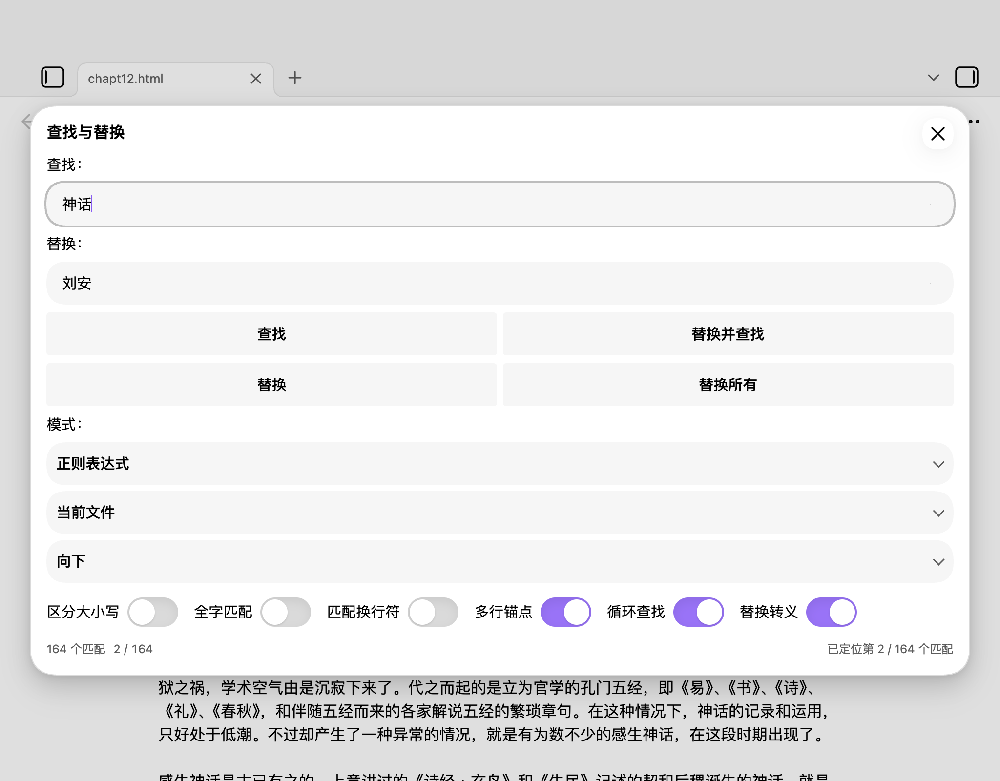
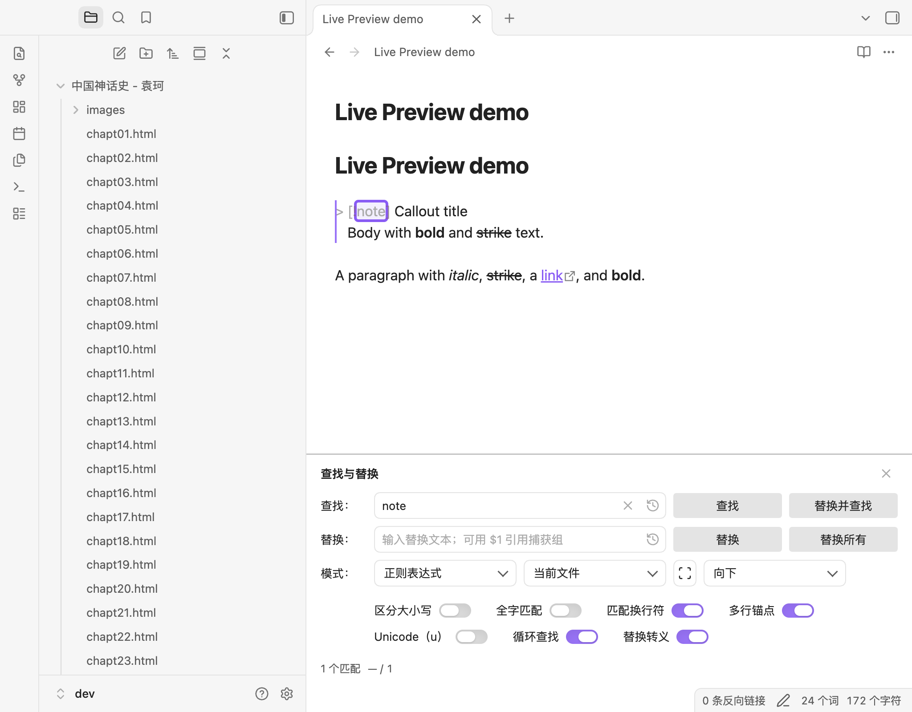

# Refined Regex Replace and More

A find/replace panel for Obsidian with **exact**, **wildcard**, and **regular expression** matching. On desktop it is embedded at the bottom of the note area, separated by a thin line with a title and close button; on mobile it falls back to a dialog.













## Features

- **Three match modes**: exact text, wildcard (`*`, `?`), and JavaScript regular expressions.
- **Four actions**: Find, Replace (one occurrence), Replace and find, Replace all.
- **Replace all continues from the current position**: it replaces only the remaining matches from the cursor or selected active match in the current direction, without wrapping, so matches already passed over are left untouched. Selection scope always replaces the whole captured selection.
- **Mode-aware search options**: native Obsidian toggle switches for case sensitive, whole word, wrap around, **Match newlines**, and **Replace escapes**. Exact mode shows 4; wildcard adds Match newlines (5); regex adds Match newlines, Multiline anchors, and **Unicode (u)** (7). Match newlines uses the `s` flag: in wildcard mode `*`/`?` can cross lines; in regex mode `.` can cross lines. Multiline anchors (`m`) are regex-only. Toggle options use generous spacing (28px desktop, 16px compact/mobile) and wrap naturally; the panel height follows the rows.
- **Inline desktop panel**: embedded at the bottom of the note display area, separated by a single high-contrast 1px line, with a title and close button. It takes layout space instead of covering the note, so the editor stays visible and interactive.
- **Compact density (opt-in)**: a denser inline panel with 26px fields, 24px buttons, 6px row gaps, and the close button moved to the status line. Every action, selector, option, and the count/position/message stays visible; the default layout and the 44px mobile dialog are unchanged. Enable **Use the compact panel layout** in settings.
- **Multi-window**: each Obsidian window has its own panel; the command targets the editor of the window it is invoked in and closing one window’s panel does not close the others.
- **All-match highlighting**: every match in the active search region is highlighted; the current match has a stronger outline, so the result set is visible while you type or step through it.
- **Live Preview reveal**: in Live Preview, a match that lands on rendered Markdown — callout markers such as `> [!note]`, emphasis and strikethrough delimiters, links, or heading markers — switches that text back to its raw source so the highlight is attached to what the pattern actually matches, instead of disappearing behind the rendered widget.
- **Current position**: a persistent `3 / 164` indicator follows Find, selection changes, replacements, and panel reopen.
- **Zero-width matches**: `^`, `\b`, and lookahead matches get a small translucent gray dot above the caret position; the active match gets a filled accent dot with a halo. The dots add no layout width.
- **Newline matches**: matches containing a line break (`\n`, `。\n`, or dotAll matches crossing lines) show a small `↵` pill at the affected line end, so an otherwise invisible newline is visible and the active break is highlighted.
- **Editor-focus navigation**: F3, Shift+F3, and Escape work while the editor has focus, not only while the find field has focus.
- **Unicode (u)**: a regex-only toggle that enables `\p{...}` property escapes and code-point matching; astral characters count as one match.
- **Accessibility**: labeled region/heading, named controls, live status, keyboard-operable toggles, and a labeled options group.
- **Themes**: Catppuccin and Minimal tested; all UI uses Obsidian CSS variables.
- **Compact actions**: the four action buttons use a desktop size close to Obsidian settings controls, with hover and pressed (accent) feedback.
- **Mobile / fallback**: the same controls in a modal dialog when Obsidian reports mobile mode.
- **Scope and direction**: current file or captured selection; **Use current selection** refreshes the captured range without reopening the panel; down or up.
- **Wrap-off bounds**: Current file searches from the cursor to the document edge; Selection always searches the whole captured selection from its top (down) or bottom (up), independent of the cursor.
- **Match count and status**: live count, invalid-regex errors, wrap/boundary feedback with separate document and selection messages, replacement results.
- **Quick clear**: each field shows a clear (×) button while it contains text; clearing the find field also resets the matches, count, and highlight.
- **History**: last 20 search and replacement terms, with a clear action.
- **Undo-safe**: every replacement is a single `editor.transaction`; one undo restores it.
- **Unicode-aware whole word**: works for Latin and CJK text, without regex lookbehind.
- **Bilingual**: English and Simplified Chinese, following Obsidian's language.

## Status

Current version: **0.3.6**, released on 2026-11-24 from tag `0.3.6`. The **0.2.6** baseline is listed in Obsidian's community directory; the 0.3.6 community-directory update is the remaining distribution step. Release audit: [COMMUNITY-READINESS.md](COMMUNITY-READINESS.md) · Changes: [CHANGELOG.md](CHANGELOG.md).

## Installation

### From the community directory

1. In Obsidian, open **Settings → Community plugins** and turn off Restricted mode if needed.
2. Browse the community directory and install **Refined Regex Replace and More**.
3. Enable the plugin.
4. Optionally assign a hotkey to **Find and replace in current file** in **Settings → Hotkeys**.

The plugin id is `regex-replace-rev`.

### From a GitHub release

Download `main.js`, `manifest.json`, and `styles.css` from the [latest release](https://github.com/hluica/obsidian-regex-replace-rev/releases/latest), place them in `<your-vault>/.obsidian/plugins/regex-replace-rev/`, and enable the plugin.

### From source

See [Development](#development) below. Build with `npm install && npm run build`, then copy the three build files into the vault plugin folder.

## Usage

Run **Find and replace in current file** from the command palette (command id `regex-replace-rev:open-find-replace`).

On desktop, the command opens the panel at the bottom of the active note. Running it again focuses the existing panel. Close it with the panel’s ✕ or Escape. The panel belongs to the note view it was opened in.

### Keyboard

| Focus                 | Key           | Action                             |
| --------------------- | ------------- | ---------------------------------- |
| Find field            | Enter         | Find next in the current direction |
| Find field            | Shift+Enter   | Find previous once                 |
| Find / replace fields | Mod+Enter     | Replace all                        |
| Find / replace fields | F3 / Shift+F3 | Find next / previous               |
| Replace field         | Enter         | Replace and find                   |
| Replace field         | Shift+Enter   | Replace once                       |
| Panel                 | Escape        | Close the inline panel             |
| Editor (panel open)   | F3 / Shift+F3 | Find next / previous               |
| Editor (panel open)   | Escape        | Close the inline panel             |
| History button        | Enter / Space | Open history menu                  |

Mod is Cmd on macOS and Ctrl elsewhere. Buttons are reachable with Tab and Enter/Space.

## Matching syntax

### Exact

The find text is literal; `*`, `?`, `.`, `$` are ordinary characters. The replacement is inserted literally (no `$1` expansion). Case sensitivity and whole-word options apply.

### Wildcard

- `*` — any sequence (including empty).
- `?` — any single character.
- `\*`, `\?`, `\\`, `\n`, `\r`, `\t` — escapes.
- By default `*` and `?` do not cross line breaks; enable **Match newlines** to let them cross lines.
- A trailing `*` consumes the rest of the line (or the rest of the document with Match newlines on); a `*` in the middle stops at the next literal so repeated matches do not swallow the document.
- Each `*` / `?` is a capture group, in order. Replacement supports `$1`…`$n`, `$&`, and `$$`.
- Character classes (`[abc]`) and quantifiers (`{n,m}`) are not supported in wildcard mode; use regex mode for those.

Example: `第*章` with replacement `第$1节` turns `第1章` into `第1节`.

### Regular expression

- JavaScript `RegExp` syntax. Enter the pattern only; do not include `/.../flags`.
- `g` is implicit. The **Case sensitive** option removes the `i` flag; **Match newlines** adds `s`; **Multiline anchors** adds `m`; **Unicode (u)** adds `u`.
- Replacement supports `$1`…`$99`, `$&`, `$$`, `` $` ``, `$'`, and `$<name>`.
- Zero-width matches (e.g. `^`, `\b`, `(?=...)`) are supported and marked in the editor.
- `u` enables `\p{...}` property escapes and matches astral characters as one code point. It is available only in regex mode.
- Lookbehind is intentionally not used, for iOS compatibility.

### Whole word

Whole word uses a Unicode boundary filter (letters, numbers, marks, and `_`), not `\b`. It works with CJK text: `项目` matches in `项目：` but not inside `本项目`.

Known edge case: with a regex alternation such as `foo|foobar`, the engine may match `foo` first and reject it at the boundary instead of trying `foobar`. Put the longer alternative first or add explicit boundaries.

### Replacement escapes

Enable the **Replace escapes** toggle in the panel to convert `\n`, `\r`, `\t`, and `\\` in the replacement before `$` expansion. The toggle is saved with the rest of the panel state. This is useful because the input fields are single-line.

### Replace all

Replace all is a remaining-work action, not a whole-scope reset. It starts at the cursor, or at the selected active match, and replaces matches in the current direction to the edge of the scope. It does not wrap, so matches behind the cursor are not replaced again after you have stepped through them with Find or Replace. A selected active match is included. If no match remains in that direction, the panel reports the document or selection boundary.

- To replace a whole file, place the cursor at the start with direction Down, or at the end with direction Up.
- **Selection** scope replaces the whole captured selection; the cursor only affects Find/Replace navigation there.
- **Current file** with wrap off already uses the cursor-to-edge region; Replace all applies the same directional rule regardless of the wrap toggle.

## Scope

- **Current file** — the whole document. Find wraps when **Wrap around** is on; Replace all still processes only the remaining matches from the current position in the selected direction.
- **Selection** — the selection captured when the panel opens or when you switch the scope to Selection. The captured range is updated after replacements. It resets to Current file if the note content changes to another document. Replace all replaces the whole captured selection.
- Use the **Use current selection** (scan) button next to the scope selector to refresh or switch to a new selection without reopening the panel.

## Settings

- **Use the compact panel layout** — 26px fields, 24px buttons, tighter spacing, and no visible title row. Takes effect the next time the panel opens; the mobile dialog keeps its 44px controls.
- **Remember the last search and options** — restore the last pattern, replacement, and options.
- **Prefill the find field from the selection** — use a single-line selection when opening.
- **Remember search history** — keep the last 20 terms; turning it off clears the history.
- **Default match mode** — used when remembering the last state is off.

All data is stored in the plugin's `data.json` under `plugin.settings`. Panel-driven saves are debounced; the settings tab saves immediately.

## Accessibility

- The panel is a labelled `region`; the inline title is a level-2 heading.
- Find/replace inputs have labels, mode/scope/direction selects have descriptive `aria-label`s, and every icon button has an accessible name.
- Toggles are native checkboxes with labels; the options row is a labelled group.
- History buttons expose `aria-haspopup="menu"` and `aria-expanded`.
- The status message uses `aria-live="polite"`; errors are textual, not color-only.
- Keyboard: Tab reaches controls, Space toggles switches, Escape closes the panel.
- The Chromium accessibility tree was audited (the same tree Chromium maps to Windows UIA); a full VoiceOver/Narrator session is still outstanding.

## Limitations

- Find and replace are limited to the current file (or captured selection); there is no vault-wide replace.
- The input fields are single-line; use regex `\n` or the panel's **Replace escapes** toggle for line breaks.
- All-match highlighting is capped at 5,000 rendered ranges, 1,000 zero-width dots, and 1,000 line-break markers; the count and position still report the full result up to the scan cap.
- A newline-only match has no visible glyph of its own; it is shown by the `↵` marker rather than a text background.
- Replace all asks for confirmation above 5,000 remaining matches and is blocked above the 100,000-match action cap; this keeps the single undoable transaction bounded.
- Word-level regex alternation has the boundary caveat described above.
- The inline panel sits at the bottom of the editor content column; in a narrow split pane it switches to a compact stacked layout. Below 260px panel width the four action buttons stack one per row. Very narrow windows cap it at 70vh and scroll internally, so the status row can be below the fold.
- Compact density is opt-in and applies to the desktop inline panel; the mobile dialog keeps its 44px controls.
- On mobile the panel is presented as a dialog rather than embedded; the modal does not draw custom highlights, but the position indicator and native selection work.
- Real iOS/Android devices and Windows/Linux were not re-tested for 0.3.6; mobile emulation was used.
- Third-party themes tested: Catppuccin and Minimal. Other themes may define unusual highlight/selection variables.
- Accessibility was audited through the Chromium accessibility tree; a full screen-reader session on macOS/Windows is still outstanding.

## Development

```bash
npm install
npm test
npx tsc -noEmit
npm run lint
npm run build
```

The build produces `main.js` at the project root; copy it with `manifest.json` and `styles.css` to a vault plugin folder. The inline panel is a CodeMirror 6 `showPanel` extension (`top: false` → bottom). The project uses TypeScript, esbuild, Vitest, ESLint with `eslint-plugin-obsidianmd`, and CodeMirror 6 packages provided by Obsidian at runtime.

## Acknowledgments

- The plugin is generated by DeepSeek-V4.1-flash-1017.
- The plugin is inspired by [obsidian-regex-replace](https://github.com/Gru80/obsidian-regex-replace).
- Its UI is inspired by Calibre Ebook-Editor.

## License

MIT. See [LICENSE](LICENSE).
