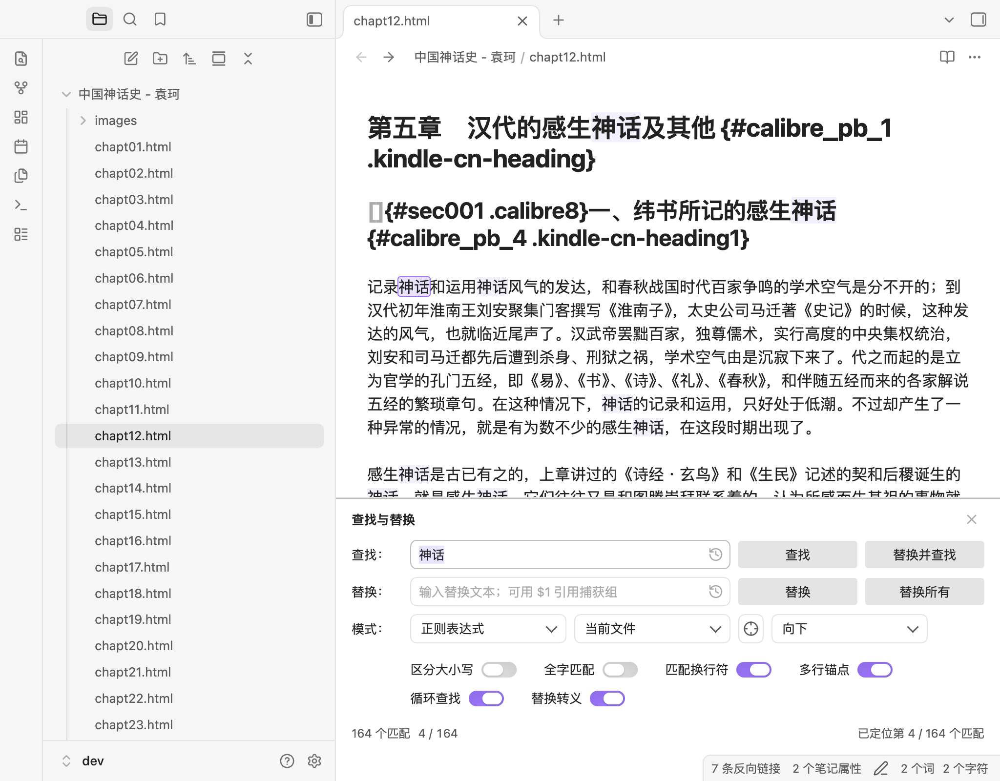
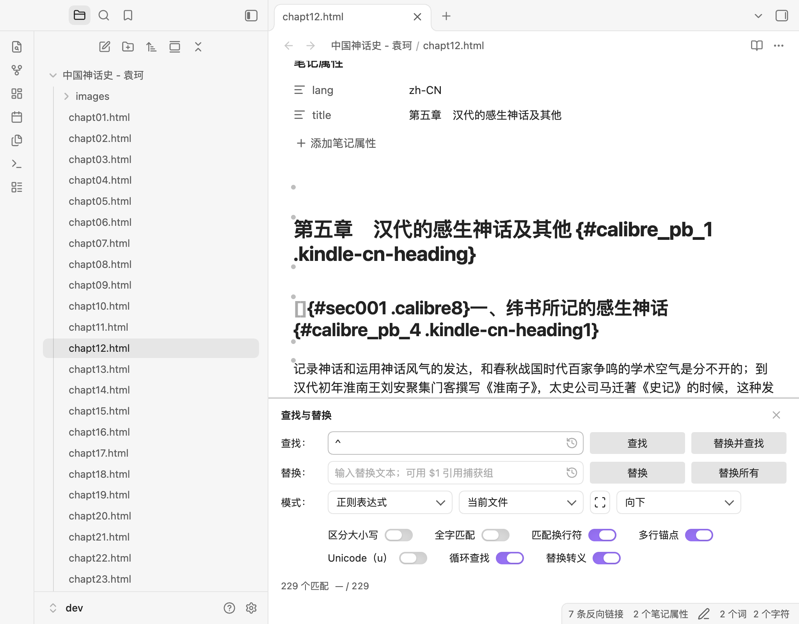
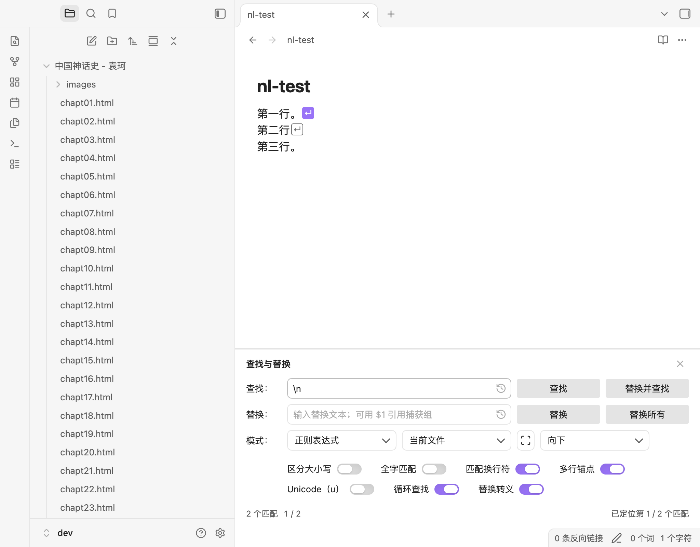
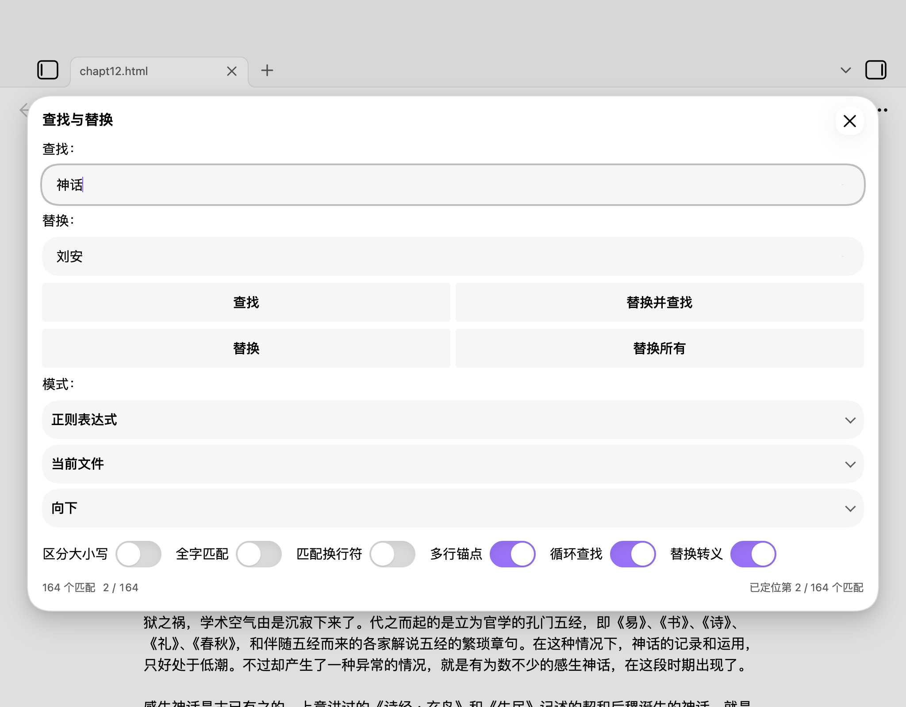

# Refined Regex Replace and More

一个 Obsidian 查找替换插件，支持**完全匹配**、**通配符**和**正则表达式**。桌面端将面板嵌入笔记显示区域底端，用一条细分隔线、标题和关闭按钮与笔记区分，非模态且不遮挡笔记；移动端回退到模态对话框。









## 功能

- **三种匹配模式**：完全匹配、通配符（`*`、`?`）、JavaScript 正则表达式。
- **四个动作**：查找、替换（仅一次）、替换并查找、替换所有。
- **随模式变化的查找选项**：区分大小写、全字匹配、循环查找、**匹配换行符**、**替换转义**，全部使用 Obsidian 原生 toggle 开关。完全匹配显示 4 项；通配符增加「匹配换行符」共 5 项；正则再增加「多行锚点」和「Unicode（u）」共 7 项。「匹配换行符」使用 `s` 标志：通配符模式下让 `*`/`?` 跨行，正则模式下让 `.` 跨行；「多行锚点」仅正则可用。选项间距更宽松（桌面 28px，紧凑/移动端 16px），放不下时自然换行，面板高度随行数调整。
- **桌面内嵌面板**：固定在笔记显示区域底端，用一条对比度较高的 1px 实线与笔记内容分隔，并带标题与关闭按钮；占据布局空间而非覆盖笔记，编辑器仍可见可交互。
- **多窗口**：每个 Obsidian 窗口拥有独立面板；命令作用于触发它的窗口中的编辑器，关闭一个窗口的面板不影响其它窗口。
- **全部匹配高亮**：当前查找区域内的所有匹配都会高亮，当前匹配使用更强的描边；输入或逐条查找时都能看到结果集。
- **当前序号**：状态行持续显示 `3 / 164`，并随查找、选区变化、替换和重新打开面板更新。
- **零宽匹配**：`^`、`\b`、lookahead 等零宽匹配在光标位置上方显示灰色半透明实心圆点，当前匹配显示填充强调色圆点并带光晕；圆点不占布局宽度。
- **换行匹配**：包含换行的匹配（`\n`、`。\n` 或跨行 dotAll 匹配）会在受影响行尾显示小 `↵` 标记，让本身没有字形的换行可见，当前换行使用强调色。
- **编辑器焦点下的导航**：面板打开时，焦点在正文也可使用 F3、Shift+F3、Escape。
- **Unicode（u）**：仅正则模式的开关，启用 `\p{...}` 属性转义和码点匹配，emoji 等星形字符按一个匹配计算。
- **无障碍**：面板是带标签的 region、标题为 heading，控件有名称、状态为 live region，选项为带标签的分组。
- **主题**：已测试 Catppuccin 与 Minimal；界面只使用 Obsidian CSS 变量。
- **紧凑按钮**：四个动作按钮采用接近设置页控件的大小，并带 hover 与按下（强调色）反馈。
- **移动端/回退**：移动模式下使用同一套控件的模态对话框。
- **范围与方向**：当前文件或捕获的选中内容；「使用当前选区」可直接刷新选区范围，无需关闭重开面板；向下或向上。
- **关闭循环查找时的范围**：当前文件从光标查找到文档边界；选中内容始终使用完整选区，向下从选区顶部、向上从选区底部开始，不受光标位置影响。
- **匹配数与状态**：实时匹配数、无效正则错误、循环/边界提示（文档边界与选中区域边界分别提示）、替换结果。
- **历史记录**：最近 20 条查找与替换文本，可清除。
- **可撤销**：所有替换通过一次 `editor.transaction` 提交，一次撤销即可恢复。
- **Unicode 全字匹配**：支持中文/日文/韩文，不使用正则 lookbehind。
- **中英文界面**：跟随 Obsidian 语言。

## 状态

当前版本 **0.3.4**，已于 2026-11-12 从 `0.3.4` tag 发布。上一个基线版本 **0.2.6** 已列入 Obsidian 社区插件目录；0.3.4 的社区目录更新是剩余的分发步骤。发布审计见 [COMMUNITY-READINESS.md](COMMUNITY-READINESS.md)，变更见 [CHANGELOG.md](CHANGELOG.md)。

## 安装

### 从社区插件目录安装

1. 在 Obsidian 的 **设置 → 第三方插件** 中关闭安全模式（如需要）。
2. 在社区插件目录中搜索并安装 **Refined Regex Replace and More**。
3. 启用插件。
4. 可在 **设置 → 快捷键** 中给「在当前文件中查找与替换」绑定快捷键。

插件 id 为 `regex-replace-rev`。

### 从 GitHub Release 安装

从 [最新 Release](https://github.com/hluica/obsidian-regex-replace-rev/releases/latest) 下载 `main.js`、`manifest.json` 和 `styles.css`，放入 `<你的库>/.obsidian/plugins/regex-replace-rev/`，然后在设置中启用。

### 从源码安装

参见下方「开发」章节：执行 `npm install && npm run build`，再把三个构建文件复制到库插件目录。

## 使用

在命令面板执行 **在当前文件中查找与替换**（命令 id `regex-replace-rev:open-find-replace`）。

桌面端会在当前笔记显示区域底端打开面板；再次执行命令会聚焦已有面板。可用面板右上角 ✕ 或 Escape 关闭。面板属于打开它的笔记视图。

### 快捷键

| 焦点        | 按键          | 动作              |
| ----------- | ------------- | ----------------- |
| 查找框      | Enter         | 按当前方向查找    |
| 查找框      | Shift+Enter   | 反向查找一次      |
| 查找/替换框 | Mod+Enter     | 全部替换          |
| 查找/替换框 | F3 / Shift+F3 | 查找下一个/上一个 |
| 替换框      | Enter         | 替换并查找        |
| 替换框      | Shift+Enter   | 替换（仅一次）    |
| 面板        | Escape        | 关闭内嵌面板      |
| 正文（面板打开） | F3 / Shift+F3 | 查找下一个/上一个 |
| 正文（面板打开） | Escape        | 关闭内嵌面板      |
| 历史按钮    | Enter / Space | 打开历史菜单      |

Mod 在 macOS 上是 Cmd，其它平台是 Ctrl。按钮均可 Tab 聚焦、Enter/Space 触发。

## 匹配语法

### 完全匹配

查找文本按字面处理，`*`、`?`、`.`、`$` 都是普通字符。替换文本按字面插入（不解析 `$1`）。支持区分大小写与全字匹配。

### 通配符

- `*`：任意长度（含空）。
- `?`：任意单个字符。
- `\*`、`\?`、`\\`、`\n`、`\r`、`\t`：转义。
- 默认 `*` 和 `?` 不跨行；开启「匹配换行符」后可以跨行。
- 末尾的 `*` 会吃掉行内剩余内容（开启「匹配换行符」时可能吞到文档剩余部分）；中间的 `*` 会在下一个字面量处停止，避免一次匹配吞掉整篇文档。
- 每个 `*` / `?` 按顺序成为捕获组。替换支持 `$1`…`$n`、`$&`、`$$`。
- 通配符模式不支持字符类 `[abc]` 与量词 `{n,m}`；请改用正则模式。

示例：`第*章` 配合替换 `第$1节`，把「第1章」变为「第1节」。

### 正则表达式

- JavaScript `RegExp` 语法；只输入模式本身，不要写 `/.../flags`。
- `g` 隐含。「区分大小写」控制 `i`；「匹配换行符」加 `s`；「多行锚点」加 `m`；「Unicode（u）」加 `u`。
- 替换支持 `$1`…`$99`、`$&`、`$$`、`` $` ``、`$'`、`$<name>`。
- 支持零宽匹配（如 `^`、`\b`、`(?=...)`），并在编辑器中显示标记。
- `u` 启用 `\p{...}` 属性转义，并把星形字符按一个码点匹配；仅正则模式可用。
- 不使用 lookbehind，兼容 iOS。

### 全字匹配

全字匹配使用 Unicode 词边界过滤（字母、数字、组合符号、`_`），不是 `\b`。因此支持中文：`项目` 会匹配「项目：」，但不会匹配「本项目」。

已知边缘情况：正则写成 `foo|foobar` 时，引擎可能先匹配 `foo`，在词边界处被拒绝后不会回溯尝试 `foobar`。请把较长的分支放在前面，或显式写边界。

### 替换转义

在面板中打开「替换转义」开关后，会先把 `\n`、`\r`、`\t`、`\\` 转成实际字符，再解析 `$` 分组；该状态随其它面板选项一起保存。由于输入框是单行，这个选项适合插入换行。

## 范围

- **当前文件**：整篇文档。
- **选中内容**：在打开面板或把范围切换到「选中内容」时捕获；替换后按增量更新终点；目标笔记切换时重置为「当前文件」。
- 同一笔记内想换选区：点击范围下拉旁的「使用当前选区」（scan）按钮，无需关闭重开面板。

## 设置

- **记住上次查找与选项**：恢复上次的查找/替换文本和选项。
- **从选中内容预填查找框**：打开时使用单行选区。
- **记住查找历史**：保存最近 20 条；关闭时清空历史。
- **默认匹配模式**：关闭「记住上次查找与选项」时使用。

所有设置保存在插件 `data.json` 的 `plugin.settings` 中。面板触发的保存有防抖，设置页保存立即生效。

## 无障碍

- 面板是带标签的 `region`，内嵌标题是 level-2 heading。
- 查找/替换输入框有 label，模式/范围/方向下拉有描述性 `aria-label`，所有图标按钮有可访问名称。
- 开关是带 label 的原生 checkbox，选项区是带标签的 group。
- 历史按钮暴露 `aria-haspopup="menu"` 与 `aria-expanded`。
- 状态消息使用 `aria-live="polite"`；错误使用文本，不只依赖颜色。
- 键盘：Tab 可达控件，Space 切换开关，Escape 关闭面板。
- 已审计 Chromium 无障碍树（Chromium 在 Windows 上映射为 UIA）；仍缺少完整 VoiceOver/Narrator 会话。

## 限制

- 只处理当前文件或捕获选区，不做全库替换。
- 输入框单行；多行替换依赖正则 `\n` 或面板中的「替换转义」开关。
- 全部匹配高亮最多渲染 5,000 个区间、1,000 个零宽圆点和 1,000 个换行标记；匹配总数和序号仍显示到扫描上限。
- 纯换行匹配本身没有字形，使用 `↵` 标记而不是文本背景显示。
- 替换超过 5,000 处时会要求确认；超过 100,000 处时拒绝执行，避免单次事务无界增长。
- 正则交替分支的整词匹配有上述边界限制。
- 内嵌面板位于编辑器内容区域底端；在很窄的分栏中会自动切换为紧凑堆叠布局；面板宽度小于 260px 时四个动作按钮改为单列。极窄窗口以 70vh 封顶并内部滚动，状态行可能需要滚动到面板底部才能看到。
- 移动端使用对话框而不是内嵌面板；模态框不绘制自定义高亮，但序号和原生选区可用。
- 0.3.4 未重新测试真实 iOS/Android 与 Windows/Linux，移动端使用模拟模式验证。
- 第三方主题仅测试 Catppuccin 与 Minimal；其它主题的 highlight/selection 变量可能不同。
- 无障碍通过 Chromium 无障碍树审计；macOS/Windows 的完整屏幕阅读器会话仍待完成。

## 开发

```bash
npm install
npm test
npx tsc -noEmit
npm run lint
npm run build
```

构建产物为根目录的 `main.js`；与 `manifest.json`、`styles.css` 一起复制到库插件目录即可。内嵌面板基于 CodeMirror 6 `showPanel`（`top: false`，即底部）。项目使用 TypeScript、esbuild、Vitest、`eslint-plugin-obsidianmd`，CodeMirror 6 包由 Obsidian 运行时提供。

## 致谢

- 本插件由 DeepSeek-V4.1-flash-1017 生成。
- 受 [obsidian-regex-replace](https://github.com/Gru80/obsidian-regex-replace) 启发。
- UI 受 Calibre Ebook-Editor 启发。

## 许可证

MIT，见 [LICENSE](LICENSE)。
